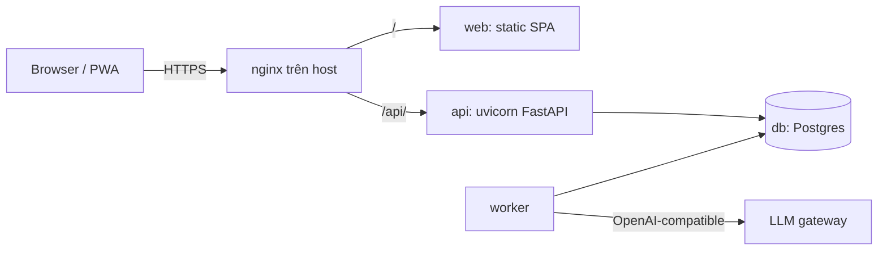
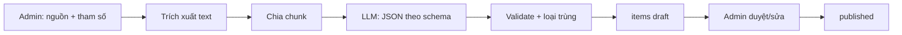

# Quizzes and Flashcards: thiết kế

Ngày: 2026-11-02. Trạng thái: chờ người dùng duyệt bản viết.
Nguồn ý tưởng: `task.md`.

## 1. Mục tiêu

Một web app học tập cá nhân cho chủ dự án và người thân. Kiến thức gồm lập trình, đầu tư, tài chính, toán và tiếng Anh. Kiến thức được nhắc lại ngắt quãng (SRS), câu hay sai quay lại thường xuyên. Admin dùng AI để sinh nội dung, rồi duyệt và dựng đề kiểm tra cố định.

Tiêu chí thành công:
- Cài được lên màn hình chính điện thoại (PWA), dùng thoải mái bằng một tay.
- Người dùng mở app thấy ngay số thẻ đến hạn hôm nay và ôn được trong vài chạm.
- Admin dán văn bản, upload PDF hoặc nhập URL, nhận về các câu hỏi/thẻ nháp theo chủ đề và level, duyệt rồi xuất bản.
- Admin dựng đề cố định theo tổng số câu, số câu theo level và theo chủ đề. Người dùng làm đề, câu sai tự vào hàng đợi ôn lại.
- Chạy ổn trên một VPS (6 core, 12 GB RAM), triển khai bằng Docker, vận hành gọn.

## 2. Phạm vi

Trong phạm vi:
- Hai khu vực trong một SPA: người dùng và admin (`/admin`).
- Tài khoản do admin tạo, đăng nhập user/password.
- Một kho nội dung chung, tiến độ ôn tập riêng cho từng người.
- Ba loại nội dung: `flashcard`, `vocab` (tiếng Anh), `question` (trắc nghiệm, đúng/sai).
- Sinh nội dung bằng LLM qua gateway tương thích OpenAI, từ văn bản dán, PDF, URL.
- SRS cho thẻ và câu hỏi. Đề cố định do admin tạo.

Ngoài phạm vi (không làm ở bản này):
- Học offline và đồng bộ. PWA chỉ cache giao diện, học cần mạng.
- Đăng ký công khai, đăng nhập Google/OAuth, quên mật khẩu qua email.
- Người dùng tự tạo nội dung hay tự cấu hình đề.
- Chấm phát âm, audio AI, luyện nghe/nói. Chỉ đọc to bằng Web Speech API của trình duyệt.
- Loại trùng theo ngữ nghĩa, OCR cho PDF scan, SSE/WebSocket, Redis.
- FSRS (có thể thay `schedule()` sau, cần migration).

## 3. Quyết định đã chốt

| Chủ đề | Quyết định |
|---|---|
| Phân loại | Kiến trúc mới, đi đủ spec rồi plan |
| Nguồn cho AI | Dán văn bản, upload PDF, nhập URL |
| Mô hình người dùng | Kho nội dung chung, tiến độ riêng |
| Tiếng Anh | Phát âm (Web Speech API), IPA, câu ví dụ do AI sinh |
| LLM | Gateway tương thích OpenAI, `openai` SDK, đổi `base_url` |
| Backend | Python 3.12+, FastAPI, uvicorn, `uv` |
| Database | PostgreSQL (JSONB), SQLAlchemy 2 async + Alembic, driver `psycopg` |
| Frontend | React + Vite + Tailwind, một SPA |
| Offline | Không. Chỉ cache app shell |
| Auth | Admin tạo user, mật khẩu băm Argon2, session cookie |
| Triển khai | Docker Compose trên VPS, nginx sẵn có trên host làm reverse proxy |
| Domain | `quizz.thangtm.io.vn`: `/` SPA, `/admin` khu admin, `/api` API |
| Đề kiểm tra | Admin tạo sẵn đề cố định |
| Worker | Container riêng, cùng image với `api` |
| Tài liệu | `docs/` là nguồn sự thật duy nhất (SSOT) |

## 4. Kiến trúc và triển khai



Bốn container trong `docker-compose`:

| Service | Vai trò |
|---|---|
| `web` | Phục vụ file build của SPA. `try_files` về `index.html` cho route phía client |
| `api` | FastAPI qua uvicorn, chỉ phục vụ `/api` |
| `worker` | Cùng image với `api`, lệnh khác. Nhận job sinh nội dung từ bảng `generation_jobs` |
| `db` | PostgreSQL, volume riêng, không publish cổng ra host |

- Cổng của `web` và `api` chỉ bind `127.0.0.1`. nginx trên host lo TLS và proxy `/` sang `web`, `/api/` sang `api`.
- nginx gửi `Cache-Control: no-cache` cho `index.html` và `sw.js` để bản mới không bị kẹt cache. Route upload và route AI cần `client_max_body_size` đủ lớn và `proxy_read_timeout` dài. `/api/auth/login` có `limit_req` ở nginx.
- Cùng origin nên không cần CORS. uvicorn phải tin `X-Forwarded-Proto` và `X-Forwarded-For` từ nginx: cookie `Secure` cần cái đầu, giới hạn đăng nhập theo IP cần cái sau. Khi cổng được publish ở `127.0.0.1`, container `api` thường thấy kết nối từ nginx đến từ địa chỉ gateway của bridge chứ không phải `127.0.0.1`, nên `forwarded-allow-ips` phải đặt đúng (cần kiểm tra thực tế).
- Bí mật (key gateway, mật khẩu DB, khóa session) nằm trong file env trên VPS, không đóng vào image.
- Migration: bước deploy chạy `docker compose run --rm api alembic upgrade head` trước khi khởi động lại `api` và `worker`. Không thêm container riêng cho migration.
- Sao lưu: cron `pg_dump` hằng đêm ra thư mục ngoài volume Docker, giữ vài bản gần nhất. Cần một lần thử restore thật khi dựng hạ tầng.

Cấu trúc repo:

```
backend/    # FastAPI app, worker entrypoint, alembic, tests
web/        # React SPA
deploy/     # docker-compose, nginx conf mẫu, script backup
docs/       # SSOT
```

## 5. Tài liệu `docs/` (SSOT)

```
docs/
  README.md       # mục lục và quy ước SSOT
  product/        # mục tiêu, phạm vi (nội dung của task.md chuyển thành vision.md)
  architecture/   # kiến trúc, data model, SRS, deploy, openapi.json
  decisions/      # ADR ngắn, mỗi quyết định một file
  specs/          # spec thiết kế (file này)
  plans/          # kế hoạch triển khai
```

Quy ước:
- Thay đổi hành vi, schema hay deploy thì cập nhật docs trong cùng commit.
- Hợp đồng API lấy từ OpenAPI của FastAPI, xuất ra `docs/architecture/openapi.json` bằng một script. Không viết tay lần hai.
- Docs lệch code thì docs là chuẩn cho tới khi có quyết định mới được ghi lại.

## 6. Mô hình dữ liệu

| Bảng | Nội dung chính |
|---|---|
| `users` | username (unique), password_hash (Argon2), role `admin`/`user`, is_active, daily_new_limit (mặc định 10), created_at |
| `sessions` | user_id, token_hash, expires_at, created_at. Token ngẫu nhiên, chỉ lưu hash |
| `login_attempts` | username, ip, at. Dùng để giới hạn thử sai |
| `topics` | name, slug (unique). Cây phẳng một cấp |
| `sources` | kind `text`/`pdf`/`url`, văn bản đã trích xuất, url (nếu có), created_by. Không giữ file PDF gốc |
| `generation_jobs` | source_id, topic_id, params JSONB, status `queued`/`running`/`succeeded`/`failed`, attempts, result JSONB (số item tạo, số item bị bỏ do trùng), error, heartbeat_at, created_by |
| `items` | topic_id, level, kind, content JSONB, status `draft`/`published`/`archived`, source_id, content_hash |
| `review_states` | PK (user_id, item_id): due_at, interval_days, ease, reps, lapses |
| `review_logs` | user_id, item_id, grade, correct, context (`study`/`exam`/`wrong_queue`), at |
| `exams` | title, status `draft`/`published`/`archived`, build_config JSONB, created_by |
| `exam_items` | (exam_id, item_id, position). Chốt khi publish |
| `exam_attempts` | user_id, exam_id, started_at, submitted_at, score |
| `attempt_answers` | attempt_id, item_id, answer JSONB, correct (null tới lúc nộp bài), answered_at |

Ràng buộc:
- `level` là enum `easy`/`medium`/`hard`/`expert`.
- `kind` là enum `flashcard`/`vocab`/`question`. `content` được validate bằng pydantic theo `kind`:
  - `flashcard`: `front`, `back`.
  - `vocab`: `word`, `part_of_speech`, `meaning`, `ipa`, `examples[]`.
  - `question`: `type` (`mcq` hoặc `true_false`), `prompt`, `options[]`, `answer`, `explanation`.
- `items` unique theo (`topic_id`, `content_hash`). `content_hash` là sha256 của khóa nội dung đã chuẩn hóa (Unicode NFC, hạ chữ thường, gộp khoảng trắng) ghép với `kind`. Khóa nội dung: `flashcard` dùng `front`, `vocab` dùng `word` + `part_of_speech`, `question` dùng `prompt`. Item `archived` vẫn giữ hash nên không tạo lại được cùng nội dung.
- Sửa đáp án đúng của một `question` đã nằm trong đề đã publish bị chặn. Muốn đổi thì archive câu cũ và tạo câu mới. Sửa các trường khác được phép.

## 7. SRS và ôn tập

Hàm thuần `schedule(state, grade, now) -> state` là điểm duy nhất tính lịch, để sau thay bằng FSRS. Thẻ chấm 4 mức: `again`, `hard`, `good`, `easy`. Câu quiz đúng tính là `good`, sai là `again`.

Tham số khởi đầu (SM-2 rút gọn, chỉnh được, ghi trong `docs/architecture/`). `due_at = now + interval_days` trừ khi ghi khác:
- Trạng thái mới: `ease = 2.5`, `reps = 0`, `lapses = 0`, `interval_days = 0`.
- `again`: `lapses + 1`, `reps = 0`, `interval_days = 0`, `ease = max(1.3, ease - 0.2)`, `due_at = now + 10 phút`.
- `hard`: `interval_days = max(1, round(interval_days * 1.2))`, `ease = max(1.3, ease - 0.15)`, `reps` giữ nguyên.
- `good`: `interval_days` = 1 nếu `reps = 0`, 3 nếu `reps = 1`, còn lại `round(interval_days * ease)`; sau đó `reps + 1`.
- `easy`: tính `g` như `good`, rồi `interval_days = max(g + 1, round(g * 1.3))`, `ease + 0.15`, `reps + 1`.

Hàng đợi (ngày tính theo `APP_TIMEZONE`, mặc định `Asia/Ho_Chi_Minh`):
- Ôn hôm nay: các `review_states` của người dùng có `due_at <= now` và item `published`, cộng thẻ mới. Thẻ mới là item `published` mà người đó chưa có `review_states`, lấy ngẫu nhiên, tối đa `users.daily_new_limit` mỗi ngày. Có thể lọc theo chủ đề và level.
- Ôn câu sai: lát cắt của hàng đợi đến hạn gồm các item có `lapses > 0`. Không có lịch riêng, một lượt trả lời chỉ cập nhật `review_states` một lần.
- Item `archived` rời hàng đợi, `review_states` được giữ lại.
- Ôn thẻ: mỗi lượt trả lời ghi `review_logs` và cập nhật `review_states` trong cùng giao dịch. Làm đề: việc này diễn ra lúc nộp bài (mục 8).
- Streak và thống kê tính từ `review_logs`, không có bảng riêng.

## 8. Đề kiểm tra do admin tạo

- Admin nhập `build_config` là danh sách dòng `(topic, level, count)`. Tổng số câu, tổng theo level và tổng theo chủ đề được tính và hiện ra khi nhập. Mỗi dòng bốc `count` câu `published` kiểu `question` đúng chủ đề và level. Thiếu câu thì báo thiếu bao nhiêu ở dòng nào, không tự bù từ level hay chủ đề khác.
- Tùy chọn "ưu tiên câu hay sai": trong mỗi dòng, xếp ứng viên theo tỷ lệ sai toàn hệ thống giảm dần (tính từ `review_logs`), câu chưa có lượt trả lời nào xếp sau cùng. Tắt thì bốc ngẫu nhiên.
- Hệ thống hiện bản xem trước, admin đổi từng câu được. Publish thì ghi `exam_items` và khóa danh sách. Đề chỉ nhận item `question`.
- Người dùng chỉ thấy đề `published`. Có thể làm lại nhiều lần, mỗi lần là một `exam_attempts` mới. Attempt dang dở tiếp tục được: đáp án lưu ngay khi chọn nhưng chưa chấm. Không giới hạn thời gian làm bài.
- Server gửi câu hỏi và lựa chọn, không gửi đáp án. Chấm ở server lúc nộp bài, lưu `attempt_answers.correct`. Cùng giao dịch đó ghi `review_logs` và cập nhật `review_states` của người đó. Kết quả cũ không đổi khi nội dung item được sửa sau này.
- Sau khi nộp, đáp án và giải thích được hiện ra. Câu sai có `lapses > 0` và đến hạn sau 10 phút, nên vào lát cắt "Ôn câu sai".
- Item bị `archived` vẫn hiển thị trong đề đã publish.

## 9. Pipeline sinh nội dung bằng AI



- Tạo nguồn (`POST /api/admin/sources`): admin dán văn bản, upload PDF (multipart) hoặc nhập URL. `api` trích xuất text ngay trong request, lưu vào `sources` và trả về bản xem trước để admin kiểm tra trước khi sinh.
  - PDF: `pypdf`, chạy trong threadpool để không chặn event loop. PDF scan không có text layer thì báo lỗi rõ ràng, không OCR.
  - URL: tải bằng `httpx` rồi đưa HTML cho `trafilatura`.
- Tạo job (`POST /api/admin/jobs`): chọn `source_id`, chủ đề, loại nội dung, số lượng theo level. `api` ghi `generation_jobs` rồi trả về ngay. Admin theo dõi tiến độ bằng polling `GET /api/admin/jobs/{id}`.
- `worker` poll bảng mỗi 2 giây, claim job bằng `SELECT ... FOR UPDATE SKIP LOCKED` và cập nhật `heartbeat_at` định kỳ. Khi poll, job `running` có heartbeat cũ hơn 5 phút được đưa về `queued` và tăng `attempts`. Quá 3 lần thì `failed`.
- Chia chunk khoảng 8.000 ký tự (cấu hình bằng env). Số item mỗi level được chia đều cho các chunk, làm tròn. Các chunk gọi LLM tuần tự.
- Gọi LLM qua `openai` SDK với `base_url` của gateway. Output phải qua validate pydantic. Lỗi thì retry một lần kèm thông báo lỗi, vẫn lỗi thì job `failed` với lý do.
- Mọi item AI sinh ra là `draft`, kèm `source_id`. Admin phải duyệt mới `published`. Đây là chốt kiểm soát chất lượng, nhất là với tài chính và toán.
- Loại trùng: so `content_hash` trong cùng chủ đề. Trùng thì bỏ. Số item đã tạo và số bị bỏ ghi vào `generation_jobs.result`.
- Giới hạn (cấu hình bằng env, giá trị mặc định): PDF tối đa 20 MB, văn bản đầu vào tối đa 200.000 ký tự, tối đa 50 item mỗi job.
- Chống SSRF cho URL: chỉ `http`/`https`; phân giải DNS rồi từ chối địa chỉ loopback, private, link-local; kết nối đúng IP đã kiểm tra (tránh DNS rebinding); kiểm tra lại sau mỗi redirect (tối đa 3); timeout 15 giây; tối đa 5 MB.
- Key gateway chỉ nằm ở env của `api` và `worker`. Không lưu vào DB, không đưa ra frontend.

## 10. Xác thực và phân quyền

- Admin tạo tài khoản và đặt mật khẩu ban đầu. Không có đăng ký công khai.
- Tài khoản admin đầu tiên tạo bằng lệnh CLI trong container `api`.
- Mật khẩu băm bằng Argon2 (`pwdlib`).
- Username: 3 đến 64 ký tự trong `[a-z0-9_.-]`, bắt đầu bằng chữ hoặc số, chuẩn hóa về chữ thường và cắt khoảng trắng đầu cuối. Mật khẩu: 8 đến 128 ký tự.
- Phiên: token ngẫu nhiên, chỉ lưu hash trong `sessions`, gửi qua cookie `HttpOnly`, `Secure`, `SameSite=Lax`. Hết hạn sau 30 ngày không dùng. Mỗi lần dùng gia hạn lại 30 ngày, nhưng chỉ ghi vào DB khi phiên được thêm hơn 1 giờ, để việc đọc không sinh ghi liên tục. Vô hiệu hoặc đổi mật khẩu một tài khoản xóa mọi phiên của nó ngay.
- Giới hạn thử sai: quá 5 lần sai trong 15 phút cho cùng username hoặc IP thì tạm khóa đăng nhập.
- Mọi request ghi (POST/PUT/PATCH/DELETE) phải có header `Origin` khớp domain, để chặn CSRF. Body là JSON, trừ endpoint upload PDF nhận multipart.
- `/api/admin/*` yêu cầu role `admin`. Route guard ở client chỉ phục vụ trải nghiệm.
- Production tắt docs và `/openapi.json` của FastAPI. Ở dev chúng nằm dưới `/api/docs` và `/api/openapi.json` để đi qua location `/api/` của nginx. `docs/architecture/openapi.json` xuất bằng script.

## 11. Frontend

SPA React Router, mỗi khu vực là một chunk lazy-load.

| Khu vực | Route |
|---|---|
| Chung | `/login` |
| Người dùng | `/` (hôm nay: thẻ đến hạn, streak), `/study`, `/review-wrong`, `/exams`, `/exams/:id`, `/vocab`, `/stats` |
| Admin | `/admin`, `/admin/topics`, `/admin/sources`, `/admin/drafts`, `/admin/items`, `/admin/exams`, `/admin/users` |

- Server state bằng TanStack Query, không thêm store toàn cục. Kiểu TypeScript sinh từ OpenAPI bằng `openapi-typescript`.
- PWA bằng `vite-plugin-pwa`: precache app shell, `/api` luôn đi mạng và không cache. Mất mạng thì hiện màn hình offline rõ ràng. Có thông báo "có bản mới, tải lại".
- UI người dùng: mobile first, thanh điều hướng dưới, thẻ lật bằng chạm, chấm 4 mức bằng nút lớn. Hướng thị giác (màu, typography, chuyển động) dùng skill frontend-design của Anthropic, token lưu trong theme Tailwind. Sáng/tối theo `prefers-color-scheme`.
- UI admin: responsive nhưng ưu tiên màn hình rộng. Bảng, form, hàng đợi duyệt draft.
- Trợ năng: tương phản đủ, focus rõ, `aria` cho thẻ lật và đáp án quiz, tôn trọng `prefers-reduced-motion`. Thiết kế không đủ để khẳng định đạt WCAG, cần thử tay với trình đọc màn hình.
- Nút nghe dùng `speechSynthesis`. Không có giọng tiếng Anh trên thiết bị thì ẩn nút.

## 12. Bộ công nghệ backend

Tham chiếu từ `pyproject.toml` do chủ dự án cung cấp, có điều chỉnh. Số phiên bản tra trên PyPI ngày 2026-11-02, chưa cài thử.

| Thay đổi so với file tham chiếu | Lý do |
|---|---|
| `passlib[bcrypt]` thành `pwdlib[argon2]` (0.3.1) | passlib dừng ở 1.7.4. README của pwdlib nêu passlib không chạy từ Python 3.13 |
| Bỏ `python-jose` | Phiên lưu trong DB, không cần JWT |
| Bỏ `langgraph`, `langchain-google-genai`, `langchain-openai` | Pipeline tuyến tính, dùng `openai` SDK trực tiếp |
| Bỏ `redis`, `sse-starlette` | Dùng polling, hàng đợi trong Postgres |
| Bỏ `aiosqlite` | Test chạy trên Postgres thật |
| Thêm `openai`, `pypdf` (6.21.4), `trafilatura` (2.3.1), `pwdlib[argon2]` (0.3.1), và `httpx` vào dependencies chạy thật | Theo pipeline mục 9 và auth mục 10. `httpx` hiện chỉ nằm ở nhóm dev, nhưng việc tải URL cần nó lúc chạy |
| Giữ `psycopg`, dùng `psycopg[binary]` (3.3.6) | Đúng với Postgres. Đã cài và chạy được trong image `python:3.12.16-slim` khi kiểm chứng plan nền tảng |

Giữ nguyên: `fastapi`, `uvicorn[standard]`, `sqlalchemy[asyncio]` (extra `asyncio` kéo `greenlet`; thiếu nó thì `sqlalchemy.ext.asyncio` không import được), `alembic`, `pydantic[email]`, `pydantic-settings`, `python-multipart`, và nhóm dev gồm `httpx`, `mypy`, `pre-commit`, `pytest`, `pytest-asyncio`, `ruff`. Phiên bản được pin chính xác trong từng plan.

## 13. Kiểm thử

- Backend: pytest trên Postgres thật qua compose. Trọng tâm: `schedule()` (các mốc và biên), builder đề (thiếu câu, khóa sau publish), chấm điểm lúc nộp, claim job song song bằng `SKIP LOCKED`, chống SSRF, giới hạn đăng nhập, phân quyền `/api/admin/*`.
- Frontend: Vitest cho logic thuần.
- Smoke test Playwright trên viewport mobile: đăng nhập, ôn thẻ, làm đề.
- Không test các thứ chỉ đi vòng (wiring, mock phản hồi lại chính nó).

## 14. Rủi ro và việc cần kiểm chứng khi viết plan

Các mục dưới đây chưa được kiểm tra, không phải quyết định bỏ ngỏ:
- Gateway LLM có hỗ trợ `response_format` kiểu JSON schema không. Nếu không, dùng prompt kèm validate và retry như mục 9.
- Phiên bản Postgres, Docker, nginx trên VPS, và địa chỉ nginx nhìn từ container để đặt `forwarded-allow-ips`.
- Đã kiểm chứng: `psycopg[binary]` cài và chạy được trong image `python:3.12.16-slim`, và uvicorn đọc đúng `X-Forwarded-For` khi cổng `api` publish ở `127.0.0.1` kèm `FORWARDED_ALLOW_IPS=*`. nginx thật trên VPS vẫn chưa được thử.
- Chất lượng nội dung AI với tài chính và toán: có chốt duyệt draft, nhưng bản thân LLM vẫn có thể sai. Admin chịu trách nhiệm kiểm tra.
- Dữ liệu nằm trong volume Docker: phụ thuộc vào cron backup và một lần restore thử.
- Domain công khai trên internet. Bảo vệ ở mức ứng dụng gồm đăng nhập, giới hạn thử sai, kiểm tra `Origin` và `limit_req` ở nginx cho trang đăng nhập. Chưa có lớp nào khác như MFA hay IP allowlist.
